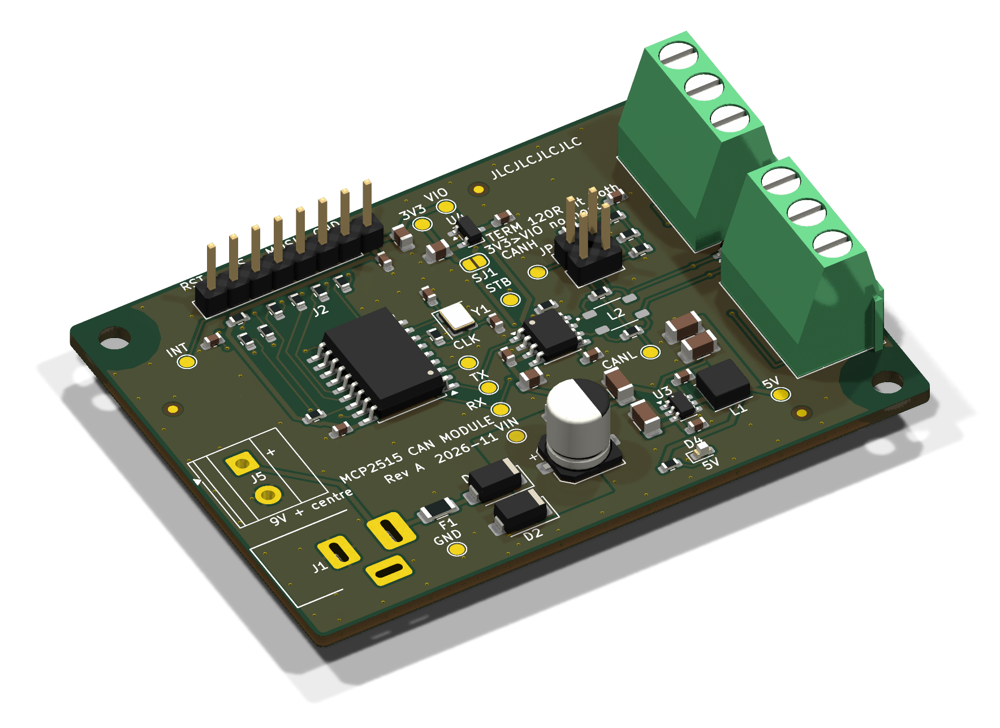
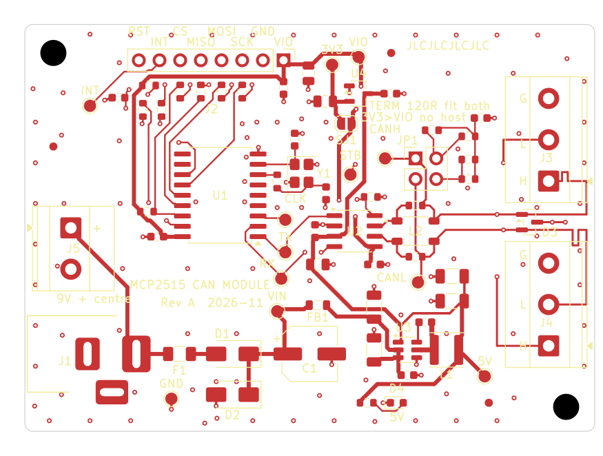
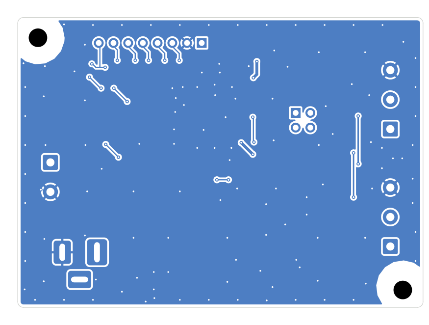

# MCP2515 CAN Bus Module — an agentic PCB design, end to end

A complete hardware design of an MCP2515-based CAN bus module, from the first requirements to a JLCPCB-ready manufacturing package. Nearly all of the engineering work was done by AI agents: **Claude Opus** as lead hardware engineer and reviewer, with **Claude Sonnet** subagents doing the research and the hands-on KiCad work. A human approved each phase before the next one started.



| | |
|---|---|
| **Board** | Rev A, 70 × 50 mm, 2-layer, 1.6 mm FR-4, 1 oz, all SMD on the top side |
| **Function** | Stand-alone CAN 2.0B controller (MCP2515) + ISO 11898-2 transceiver (TCAN1042), SPI to any 3.3 V or 5 V host |
| **Power** | 9 V DC input (7–16 V operating), protected, 5 V buck on board |
| **Design size** | 73 components, 43 nets, 4 schematic sheets |
| **Checks** | ERC 0 · DRC 0 · schematic/PCB parity 0 · 0 unconnected pads |
| **Status** | Phase 8 complete: validated for a prototype order. **Not yet fabricated or bench-tested.** |

---

## 1. What the board does

```
 9V ─J1─[PTC]─[SS34]─[TVS + 100µF]─[ferrite]─[AP63205 5V buck]─┬─ +5V ──► TCAN1042 VCC (bus side)
                                                                └─[3.3V LDO]·· SJ1 (open) ··┐
                                                                                            ▼
 Host ─J2─ VIO (3.0–5.5 V) ─────────────────────────────────────────┬──► MCP2515 VDD
        SCK, MOSI, CS, RST ──► MCP2515 ◄── 16 MHz crystal           └──► TCAN1042 VIO
        MISO, INT ◄─────────── MCP2515
                                 │TXCAN ▲RXCAN
                                 ▼      │
                         TCAN1042 ──[CMC footprint, DNP]──[split 120 Ω, JP1]──[CAN TVS]── J3 / J4
```

The main architecture decision (D-001) is a **host-referenced logic domain**. The MCP2515 and the transceiver's logic pins both run from the host's own `VIO` pin, so the board works with a 3.3 V ESP32/STM32 or a 5 V Arduino without level shifters and without a jumper that could put 5 V into a 3.3 V host. The transceiver's bus side runs from an on-board 5 V rail, so the CAN levels are full ISO 11898-2 whatever the host voltage.

Other features:
- Reverse-polarity, overcurrent (PTC) and transient (TVS) protection on the 9 V input
- ±20 kV ESD protection on CAN_H / CAN_L (PESD2CANFD27V), placed at the connectors
- Split 2 × 60 Ω termination with a 4.7 nF centre tap, both legs switched by jumper JP1
- Two CAN terminals for daisy-chaining, an optional common-mode choke footprint, an optional 3.3 V LDO for testing without a host
- Exact bit timing at 125 k / 250 k / 500 k / 1 Mbit/s from the 16 MHz crystal
- 12 labelled test points, 3 fiducials, 2 × M3 mounting holes

## 2. How the agents worked

### Roles

| Role | Model | Did |
|---|---|---|
| Human | — | Wrote the brief, answered open questions, **approved every phase** before the next started, made sourcing calls (e.g. the MCP2515 part number change) |
| Lead engineer / reviewer | Claude Opus | Requirements, architecture, every design decision and calculation, plans for each phase, and **independent verification** of everything the builders produced |
| Researchers / builders | Claude Sonnet subagents | Datasheet extraction, JLCPCB capability research, schematic capture and PCB layout in KiCad through the KiCad MCP server, manufacturing exports, stock checks |

### Rules that kept it honest

1. **One source of truth.** [`docs/ENGINEERING_SPEC.md`](docs/ENGINEERING_SPEC.md) holds every requirement (R-xx), decision (D-001…D-032), open question (Q-xx) and a change log. Every session read it first, and Sonnet was not allowed to override a decision marked APPROVED.
2. **Phase gates.** Eight phases, each ending with a written report and a human approval. No phase started before the previous one was approved.
3. **Every number is tagged.** `[DS]` datasheet-verified with document and section, `[DS-pending]` quoted from memory and still to be checked, `[CALC]` calculated, `[ASSUME]` assumption, `[TEST]` needs a bench check. Values from memory were not used for final choices until a datasheet confirmed them.
4. **Plan → build → independent review.** Opus wrote the plan, Sonnet built it, then Opus re-checked with its own tools instead of trusting the builder's report: it re-ran ERC/DRC itself, parsed a fresh netlist export with its own parser, compared symbol pin maps with the datasheets, measured distances in the PCB with a pcbnew script, and opened every render.
5. **Margins over minimums.** JLCPCB rules were researched first and every project rule sits above JLC's limits (e.g. 0.15 mm track/space vs 0.10, 0.3 mm vias vs 0.15).

### The eight phases

| Phase | What happened | Output |
|---|---|---|
| 1. Requirements & architecture | Brief turned into requirements; derived requirements proposed (7–16 V input, VIO 3.0–5.5 V, ≤ 100 × 100 mm); block diagram, voltage domains, current budget; JLCPCB capabilities researched and copper-pour strategy set | [Spec §1–§6](docs/ENGINEERING_SPEC.md), [`jlcpcb_capabilities.md`](docs/research/jlcpcb_capabilities.md) |
| 2. Component selection | Candidates scored per function against datasheets, JLC stock and Basic/Extended class. Found that the planned P-MOSFET reverse-polarity stage would be overstressed at the TVS clamp voltage → switched to an SS34 Schottky (D-006r) | [`phase2_component_selection.md`](docs/phase2_component_selection.md), [`research/`](docs/research/) |
| 3. Power supply | LDO vs buck trade: LDOs fail thermally at 16 V / 85 °C → AP63205 buck. Full input protection chain and abs-max check at the 29.2 V clamp | [`phase3_power_supply.md`](docs/phase3_power_supply.md), [`power_budget.xlsx`](docs/power_budget.xlsx) |
| 4. MCP2515 & oscillator | 16 MHz crystal, load caps, drive level, bit-timing register values, reset and SPI conditioning | [`phase4_mcp2515_oscillator.md`](docs/phase4_mcp2515_oscillator.md) |
| 5. CAN physical layer | Transceiver mode pins, termination, TVS, choke option, bus-length limits | [`phase5_can_phy.md`](docs/phase5_can_phy.md) |
| 6. Schematic | Sonnet captured a hierarchical KiCad schematic (Power / Controller / CAN PHY). Opus review: ERC 0, every net checked, one annotation fix (J1B → J5) | [Schematic PDF](docs/schematic/MCP2515_CAN_schematic.pdf), [`phase6_schematic_review.md`](docs/phase6_schematic_review.md) |
| 7. PCB layout | Sonnet placed and routed with its own scripts (placement legaliser, grid A* router, zone/stitching/silk scripts; CAN pair by hand coordinates). Opus review found issues, one correction round fixed them, DRC 0 | [`phase7_pcb_review.md`](docs/phase7_pcb_review.md), [`pcb/layout_report.md`](docs/pcb/layout_report.md) |
| 8. Validation & manufacturing | Gerbers, drill, JLC BOM and CPL, stock check, requirement traceability, risk register, bring-up guide | [`final_design_validation.md`](docs/final/final_design_validation.md), [`manufacturing/`](docs/manufacturing/) |

### What the reviews caught

These are real issues caught by the review step before they reached a board:

- **P-MOSFET overstress (Phase 2):** gate–source and drain–source ratings would be exceeded when the input TVS clamps at 29.2 V, so the reverse-polarity stage was changed to a Schottky diode.
- **Transceiver standby default (Phase 2):** the TCAN1042 STB pin defaults to standby when left open, so a 10 kΩ pull-down was added. Without it the bus would stay silent.
- **No internal reset pull-up (Phase 2):** the MCP2515 has none, so an external 10 kΩ + 10 nF RC was added.
- **INT pin type (Phase 2):** it had been assumed open-drain; the datasheet shows push-pull, so a "don't share INT between modules" warning was documented.
- **ESD diode too far from the connectors (Phase 7):** the first layout put D3 12–18 mm away, with the bus able to branch before it. It was moved between J3/J4 so it is the first thing on the bus.
- **Terminal block drill too small (Phase 7):** the stock footprint had a 1.3 mm drill for a pin that needs 1.4 mm. A project footprint was made with 1.4 mm drill / 2.6 mm pad.
- **Courtyard too close to the edge (Phase 7):** D2 was 2.25 mm from the board edge against a 2.5 mm rule, so it was moved (now ≥ 2.7 mm).
- **Ambiguous "+ centre" silkscreen (Phase 7):** fixed.
- **End-of-life part (Phase 8):** JLC listed the MCP2515 part C12368 as no longer manufactured. It was switched to C153782 (MCP2515T-I/SO, same chip on tape and reel), and ERC/DRC were re-run.

### Tools

- **KiCad 10.0.8**, driven by Sonnet through a KiCad MCP server, plus `kicad-cli` for ERC, DRC, netlist, Gerber, drill, PDF and STEP exports
- Python scripts (pcbnew and s-expression parsing) for placement, routing, measurement and independent netlist checks
- Datasheets from the manufacturers and LCSC, and JLCPCB's own capability pages and KiCad export guide, all cited by URL in the research files
- Claude Code (desktop app) as the agent harness

## 3. Key design numbers

| Item | Value |
|---|---|
| +5V worst-case load | 114 mA (incl. 100 mA bus-short current) vs 150 mA design, buck rated 2 A |
| Hottest part | ≈ 45 mW (buck), so no thermal design needed |
| Input abs-max check | Everything survives the 29.2 V TVS clamp (SS34 40 V, C1 35 V, buck 35 V) |
| Reverse input | 16 V reverse blocked by D1 (40 V rating) |
| Bit timing (CNF1/2/3) | 1M 0x00/0x83/0x01 · 500k 0x00/0xAE/0x01 · 250k 0x01/0xAE/0x01 · 125k 0x03/0xAE/0x01 |
| Max bus length | ≈ 10–15 m at 1 Mbit/s, 52 m at 500k, 140 m at 250k, 315 m at 125k |
| Layout | Crystal 28 mm from the buck inductor; buck hot loop ≈ 4 mm²; decoupling ≤ 2 mm from pins; solid bottom ground; 126+ stitching vias; CAN pair length-matched |
| JLC rules | Track/space 0.15/0.15 mm min, vias 0.3/0.6 mm, copper 0.5 mm from edge, silk ≥ 1 mm |
| Component cost | ≈ $8.50 per board (Sonnet estimate, excl. PCB, assembly and Extended-part fees) |

## 4. Repository map

| What | Where |
|---|---|
| Spec, decisions and change log | [`docs/ENGINEERING_SPEC.md`](docs/ENGINEERING_SPEC.md) |
| Phase reports | `docs/phase2…phase7_*.md`, block netlists `docs/*_netlist.md` |
| Datasheet extracts & JLC research | [`docs/research/`](docs/research/) |
| KiCad project | [`kicad/MCP2515_CAN/`](kicad/MCP2515_CAN/) (with custom footprints in `MCP2515_CAN.pretty/`) |
| Schematic | [PDF](docs/schematic/MCP2515_CAN_schematic.pdf), sheet PNGs, netlist, BOM, ERC report in [`docs/schematic/`](docs/schematic/) |
| PCB | renders, layer images, DRC report, [3D STEP](docs/pcb/MCP2515_CAN.step) in [`docs/pcb/`](docs/pcb/) |
| Manufacturing (JLCPCB) | [Gerber zip](docs/manufacturing/MCP2515_CAN_RevA_gerbers.zip), BOM, CPL, rotation review, stock check in [`docs/manufacturing/`](docs/manufacturing/) |
| Final docs | [validation](docs/final/final_design_validation.md), [BOM](docs/final/BOM_final.csv), [connector pinouts](docs/final/connector_pinouts.md), [design notes](docs/final/design_notes.md), [testing & commissioning](docs/final/testing_commissioning.md) |

| Top copper + silk | Bottom copper |
|---|---|
|  |  |

## 5. What's still open

The design is validated on paper, not on a bench. The full risk register (K-01…K-17) is in [`final_design_validation.md` §9](docs/final/final_design_validation.md). The main items:

- **Before paying for the order:** check every part's rotation and polarity in JLC's placement preview, especially D1, D2, LED D4 and crystal Y1, which had no rotation-database rule. A reversed D2 would short the input. Also re-check stock and Extended-part fees.
- **On the first boards:** measure crystal drive level at 5 V VIO (calculated 227 µW vs 200 µW max; fit R4 ≈ 1 kΩ if needed), crystal frequency via CLKOUT, and +5V ripple at idle and under 1 Mbit/s traffic. Also check the fit of the three footprints made from datasheet drawings (barrel jack, terminal blocks, choke).
- **Not tested:** EMC emissions and IEC 61000-4-2 ESD.
- **Usage limits:** 7–16 V supplies only, centre-positive jack; ≤ 10 m bus at 1 Mbit/s; not for 24 V vehicle buses (the 27 V TVS standoff would conduct at charge voltage); one INT line per module.

The bring-up order and expected readings are in [`testing_commissioning.md`](docs/final/testing_commissioning.md).
