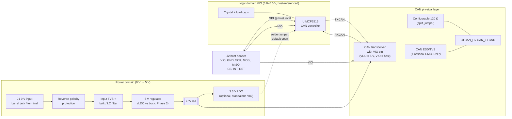

# MCP2515 CAN Bus Module — Engineering Specification (source of truth)

| Field | Value |
|---|---|
| Project | MCP2515-based CAN bus module, external 9 V DC input |
| Board revision | Rev A (not yet released) |
| Fab / assembly | JLCPCB (PCB + PCBA) |
| Current phase | **Phase 8 — Final validation complete (Rev A ready for prototype order, pending user order-time checks)**; Phases 1–7 approved |
| Spec owner | Opus (lead HW engineer) — Sonnet must not override decisions marked APPROVED |

Value tags used throughout:
- **[DS]** datasheet-verified (URL + section given). **[DS-pending]** a datasheet value quoted from prior knowledge, to be verified with page/section in Phase 2 — not yet relied on for final values.
- **[CALC]** calculated here. **[ASSUME]** design assumption. **[TEST]** needs bench verification.

---

## 1. Requirements

### 1.1 Functional requirements (from brief)
| ID | Requirement |
|---|---|
| R-01 | Stand-alone CAN 2.0B controller (MCP2515) with SPI to an external MCU |
| R-02 | CAN transceiver, ISO 11898-2 high-speed physical layer, up to 1 Mbit/s |
| R-03 | Powered from an external 9 V DC supply |
| R-04 | On-board regulation for all internal rails |
| R-05 | Host interface must work with 3.3 V hosts (ESP32, STM32) **and** 5 V hosts (Arduino Uno/Nano/Mega) without damaging either |
| R-06 | CAN_H / CAN_L connector, plus signal ground reference |
| R-07 | User-configurable 120 Ω bus termination |
| R-08 | Reverse-polarity and transient protection on the 9 V input |
| R-09 | ESD protection on CAN_H / CAN_L |
| R-10 | Filtering and decoupling per datasheets |
| R-11 | Manufacturable and assemblable by JLCPCB, within their standard capabilities (see `research/jlcpcb_capabilities.md`) |
| R-12 | Copper pours used wherever electrically beneficial (ground reference, thermal spreading, shielding) |

### 1.2 Derived / proposed requirements (Opus) — need user confirmation where marked ❓
| ID | Requirement | Basis |
|---|---|---|
| DR-01 | Input operating range ❓ proposed **7 V – 16 V**, survive ‑16 V reverse and short transients | 9 V adapters often sit 9.5–12 V unloaded; 16 V covers a mis-plugged 12 V adapter **[ASSUME]** |
| DR-02 | Host logic level selected by the host's own VIO, range 3.0–5.5 V | R-05; avoids a user-set jumper that can destroy a 3.3 V host |
| DR-03 | SPI clock up to 10 MHz end to end | MCP2515 max SPI clock 10 MHz **[DS-pending]** |
| DR-04 | CAN bit rates 125 k / 250 k / 500 k / 1 Mbit/s with exact bit timing | Phase 4 crystal choice must divide cleanly |
| DR-05 | CAN bus pins survive ±27 V DC (miswire to 24 V systems) ❓ | Transceiver bus-fault rating + TVS choice in Phase 5 |
| DR-06 | Board ≤ 100 × 100 mm (JLC price tier), target ~ 50 × 35 mm, 2 × M3 holes | **[ASSUME]** ❓ |
| DR-07 | All SMD parts on top side only (single-sided JLC PCBA) | Lowest assembly cost |

---

## 2. System architecture

### 2.1 Block diagram



ASCII fallback:
```
 9V ─J1─[Rev-pol]─[TVS + filter]─[5 V reg]─┬─ +5V ──────────────► Transceiver VDD
                                           └─[3.3 V LDO]·· SJ (open) ··┐
                                                                       ▼
 Host ─J2─ VIO ───────────────────────────────────────────────┬──► VIO net
        GND, SCK, MOSI, CS, RST ──► MCP2515 (VDD = VIO)        ├──► MCP2515 VDD
        MISO, INT ◄─────────────── MCP2515                     └──► Transceiver VIO
                                     │TXCAN  ▲RXCAN
                                     ▼       │
                               Transceiver (VDD 5 V, VIO = host) ── CAN_H/CAN_L
                                     │
                         [CMC (DNP)]─[ESD TVS]─[Split term + jumper]─J3
```

### 2.2 Signal flow
1. **Host → controller:** the MCU drives SCK, MOSI, CS (and optionally RST) at its own logic level. Because the MCP2515 is powered from the same VIO, these are same-domain connections — no translation, no added propagation delay at 10 MHz SPI.
2. **Controller → host:** MISO (tri-stated when CS high) and INT (push-pull, active-low — DS20001801K Table 13-1) return at VIO level, so a 3.3 V ESP32 never sees 5 V.
3. **Controller → transceiver:** MCP2515 TXCAN/RXCAN swing 0–VIO. The transceiver's VIO pin sets its TXD threshold and RXD output level to the same VIO, so this link is also same-domain.
4. **Transceiver → bus:** the transceiver's bus side runs from the on-board 5 V rail, giving full ISO 11898-2 differential levels regardless of host voltage (this is why a 3.3 V-only transceiver is not preferred — see D-003).
5. **Bus side protection:** CAN_H/CAN_L pass an optional common-mode choke footprint (0 Ω/DNP by default), a dual-line CAN TVS to GND, then the connector. Termination is a split 2 × 60 Ω with centre-tap capacitor to GND, enabled by a jumper.
6. **Power:** 9 V → reverse-polarity protection → TVS + bulk/LC filter → 5 V regulator → transceiver VDD (and an optional 3.3 V LDO that can be strapped to VIO for standalone testing).

### 2.3 Voltage domains
| Domain | Net | Nominal | Source | Loads |
|---|---|---|---|---|
| Raw input | `VIN_RAW` | 9 V (7–16 V) | J1 | Reverse-polarity element only |
| Protected input | `VIN` | VIN_RAW − ~0.05 V (P-FET) | After protection | 5 V regulator, input bulk |
| 5 V | `+5V` | 5.0 V ± 3 % | On-board regulator | Transceiver VDD, 3.3 V LDO, power LED |
| Logic (host) | `VIO` | 3.0–5.5 V | Host header pin | MCP2515 VDD, transceiver VIO, pull-ups |
| Optional 3.3 V | `+3V3` | 3.3 V | LDO from +5V | Only reaches VIO through SJ (default open) |
| Ground | `GND` | 0 V | Single solid ground plane | Everything; CAN GND pin tied to plane |

### 2.4 Interface boundaries
| Connector | Pins (proposed) | Domain | Notes |
|---|---|---|---|
| J1 power | VIN_RAW, GND | Raw input | 5.5 × 2.1 mm barrel **and/or** 2-pin 5.08 mm terminal ❓ |
| J2 host | VIO, GND, SCK, MOSI, MISO, CS, INT, RST (1 × 8, 2.54 mm) | VIO | Pin order chosen for short host jumpers; silk labels |
| J3 CAN | CAN_H, CAN_L, GND (3-pin 5.08 mm terminal) + optional 2nd terminal for daisy-chain ❓ | Bus | GND so remote nodes share reference |
| JP1 termination | 2×2 2.54 mm header + 2 shunts (both poles) | Bus | Both fitted = 120 Ω split termination enabled (rev Phase 5) |
| SJ1 | VIO ← +3V3 solder jumper | Logic | Default open; only for no-host testing |
| TPs | VIN, +5V, VIO, GND, CAN_H, CAN_L, TXCAN, RXCAN, SCK, INT | — | Test pads, labelled |

### 2.5 Current budget (preliminary — refined in Phase 3)
| Load | Rail | Worst-case current | Basis |
|---|---|---|---|
| CAN transceiver, dominant, 60 Ω bus | +5V | ~70 mA | Typical MCP2562/TJA1051 IDD dominant is 45–70 mA **[DS-pending]** |
| Power LED | +5V | 2 mA | **[CALC]** (5 − 2)/1.5 k |
| 3.3 V LDO quiescent (unloaded) | +5V | < 0.1 mA | **[ASSUME]** |
| **+5V total** | | **≈ 75 mA, design for 100 mA** | margin **[ASSUME]** |
| MCP2515 operating | VIO (host) | 5–10 mA | **[DS-pending]** |
| Transceiver VIO | VIO (host) | < 1 mA | **[DS-pending]** |
| **Host must supply on VIO** | | **≈ 10 mA** | ESP32/Arduino/STM32 3.3/5 V pins easily supply this |

Linear 5 V regulator dissipation at 100 mA **[CALC]**: 9 V → (9 − 5) × 0.1 = 0.40 W; at 16 V → 1.1 W. This is the main input to the LDO-vs-buck trade in Phase 3.

---

## 3. Architecture decisions

| ID | Decision | Status | Rationale |
|---|---|---|---|
| D-001 | **Host-referenced logic domain:** MCP2515 VDD and transceiver VIO are both powered from a `VIO` pin on the host header. No level translators. | APPROVED | MCP2515 operates 2.7–5.5 V **[DS-pending]**, so it can live at either host level. Removes translator parts, their 10 MHz SPI timing risk, and the "wrong jumper kills a 3.3 V host" failure. Alternative (fixed 3.3 V or 5 V MCP2515 + dual-supply buffers on 6 lines) is rejected for added cost/complexity with no benefit. |
| D-002 | Transceiver bus side on a **fixed on-board 5 V** rail derived from 9 V | APPROVED | ISO 11898-2 dominant levels need a 5 V supply for full margin; keeps bus drive current (~70 mA) off the host. |
| D-003 | Transceiver must have a **separate VIO/VCC-logic pin** (1.8–5.5 V class) | APPROVED | Needed by D-001. Candidates for Phase 2: MCP2562 (VIO pin), TJA1051T/3 (VIO pin), TCAN1462/TCAN332-class. SN65HVD230 (3.3 V-only, no VIO) does not satisfy D-001/D-002 and will be scored but is expected to be rejected. |
| D-004 | Split termination: 2 × 60 Ω (matched, 1 %) + 4.7 nF centre tap to GND, enabled by 2-pole jumper JP1 (2×2 header, rev Phase 5) | APPROVED | Improves common-mode noise rejection vs a single 120 Ω; values finalised in Phase 5. |
| D-005 | CAN bus protection: dual-line CAN-rated TVS at the connector, optional common-mode choke footprint fitted with 0 Ω by default | APPROVED | Choke only needed for EMC-critical installs; footprint costs nothing. |
| D-006 | Input chain order: connector → reverse-polarity → TVS → bulk + filter → regulator. **Revised D-006r (2026-11-02, PROPOSED): reverse-polarity element changed from P-MOSFET to SS34 Schottky** — see phase2 report §2.4 (P-FET Vgs/Vds overstress at 29.2 V TVS clamp) | APPROVED (incl. D-006r) | TVS after the polarity element so a reversed supply can't forward-bias it into a short. Details Phase 3. |
| D-007 | Optional on-board 3.3 V LDO with VIO solder jumper (default open) | PROPOSED ❓ | Enables bring-up without a host. Could be deleted to simplify — user choice. |
| D-008 | Single unbroken ground; no split analog/digital grounds | APPROVED | Board has no precision analog; splits only create return-path problems. |
| D-009 | **PCB: 2-layer, 1.6 mm FR-4, 1 oz**, top = components + signals + GND pour, bottom = near-solid GND pour, stitching vias; 4-layer only if Phase 3 selects a buck regulator and layout can't keep the hot loop compact ❓ | APPROVED | Signals are slow (CAN ≤ 1 Mbit/s, SPI ≤ 10 MHz); 2-layer with solid bottom ground is adequate and cheapest at JLC. |
| D-010 | **Copper pour strategy** (R-12): GND pour on both layers with stitching vias (≈ every 5–8 mm and along board edges); ground guard ring around crystal with no other nets under it; local wider copper on VIN/+5V for regulator heat spreading with thermal vias; pours pulled back ≥ 0.5 mm from board edge; no pour slivers/islands (remove unconnected islands); thermal reliefs on THT connector pads for hand-solderability | APPROVED | Numeric rules finalised once JLC capabilities are verified. |
| D-011 | Assembly: all SMD top-side, JLC Basic parts preferred, THT connectors either JLC-assembled or hand-soldered ❓ | PROPOSED | Minimises JLC Extended-part fees. |

---

### 3.1 Phase 2 component decisions (APPROVED 2026-11-02 — see `phase2_component_selection.md`)
| ID | Decision |
|---|---|
| D-012 | U1 MCP2515 (SOIC-18 W) — LCSC **C153782** MCP2515T-I/SO (changed 2026-11-03 from C12368, which JLC lists as no longer manufactured) |
| D-013 | U2 TCAN1042HGVDR, LCSC C124014; approved drop-in alternates TJA1051T/3/1J, MCP2562-E/SN (same pinout, pin 8 pulled low = normal on all) |
| D-014 | U3 shortlisted AP63205WU-7 fixed-5 V buck; final LDO-vs-buck in Phase 3 |
| D-015 | U4 TLV75533PDBVR 3.3 V LDO (optional VIO source) |
| D-016 | D1 SS34 Schottky (Basic); D2 SMAJ18A input TVS |
| D-017 | D3 PESD2CANFD27V-TR CAN TVS, conditional on datasheet check; fallback NUP2105LT1G with DR-05 relaxed to ≤ 24 V |
| D-018 | Y1 16 MHz YXC X322516MLB4SI (Basic), CL 9 pF |
| D-019 | Termination 4 × 120 Ω 1 % 0603 (Basic) as 2 × 60 Ω legs + 4.7 nF X7R centre tap |
| D-020 | Connectors: PJ-002AH barrel, KF128-5.08 terminals (2P alt power DNP, 3P ×2 CAN), 1×8 + 1×2 2.54 mm headers |

### 3.2 Phase 3 power decisions (APPROVED 2026-11-02 — see `phase3_power_supply.md`)
| ID | Decision |
|---|---|
| D-021 | U3 = AP63205WU-7 buck (LDOs fail thermally at 16 V / 85 °C); L1 SWPA4020S4R7MT 4.7 µH; Cout 2 × 22 µF 25 V 1206; Cin 2 × 10 µF 50 V 1206 + 100 nF; EN tied to VIN |
| D-022 | Input chain J1 → F1 PTC 0ZCJ0035AF2E → D1 SS34 → D2 SMAJ18A + C1 100 µF 35 V Al → FB1 GZ2012D601TF → buck |
| D-015r | U4 changed to XC6206P332MR (Basic, datasheet verified); pinout 1 VSS, 2 VOUT, 3 VIN |
| D-023 | 2-layer board confirmed adequate for the buck at ≤ 0.55 A peak switch current |

### 3.3 Phase 4 decisions (APPROVED 2026-11-02 — see `phase4_mcp2515_oscillator.md`)
| ID | Decision |
|---|---|
| D-024 | 16 MHz, 10 pF C0G load caps, R_S 0 Ω footprint on OSC2 (drive-level option), RF internal |
| D-025 | Bit timing: 1M 0x00/0x83/0x01; 500k 0x00/0xAE/0x01; 250k 0x01/0xAE/0x01; 125k 0x03/0xAE/0x01 |
| D-026 | Reset: 10 kΩ pull-up + 10 nF to GND on RST_N, 1 kΩ to pin 17, exposed on J2-8 |
| D-027 | SPI/INT: 33 Ω series on all five signals; 10 kΩ CS pull-up to VIO; INT push-pull; unused TXnRTS/RXnBF NC; CLKOUT to test pad only |

### 3.4 Phase 5 decisions (APPROVED 2026-11-02 — see `phase5_can_phy.md`)
| ID | Decision |
|---|---|
| D-017 | (final) D3 = PESD2CANFD27V-TR, verified |
| D-028 | U2 STB pin 10 kΩ to GND (Normal mode), TP_STB |
| D-029 | Split termination 4 × 120 Ω + 4.7 nF, both legs switched by JP1 2×2 header |
| D-030 | Order at bus: J3/J4 → D3 → termination → L2 (DNP, 0 Ω bypass) → U2 |

### 3.5 Phase 6 (see `phase6_schematic_review.md`)
| ID | Decision |
|---|---|
| D-031 | KiCad project `kicad/MCP2515_CAN/`, hierarchical (Power / Controller / CAN PHY); ERC 0; alt power terminal renamed J1B → **J5** |

### 3.6 Phase 7 (see `phase7_pcb_review.md`)
| ID | Decision |
|---|---|
| D-032 | Board 70 × 50 mm, 2-layer; D3 at J3/J4; KF128 project footprints (1.4 mm drill); DRC/parity 0 |

## 4. Implementation constraints identified (Phase 1)
Phase 2 update: items 1–2 are closed by the TCAN1042 datasheet (Table 9-2 "Protected" mode: bus high-Z when either VIO or VCC is under-voltage); item 3 closed (FOSC ≤ 25 MHz at 2.7–5.5 V, 16 MHz chosen); item 4 confirmed by SPI timing diagrams (TDIS 100 ns). New: transceiver pin 8 (STB) defaults to standby when open, so it must be pulled low; MCP2515 RESET needs external pull-up (none internal).

1. VIO must be present for the controller to run; with 9 V present and VIO absent, the transceiver TXD sees no driver. Transceiver TXD-dominant time-out / VIO under-voltage behaviour must be checked in Phase 5 so an unpowered controller can never hold the bus dominant. **[DS-pending]**
2. With 9 V absent but VIO present, the transceiver must present high impedance to the bus and must not back-feed VIO into +5V. **[DS-pending]**
3. MCP2515 oscillator maximum frequency depends on VDD; at VIO = 3.3 V the chosen crystal must be within the low-voltage limit. **[DS-pending — Phase 4]**
4. INT (and MISO when CS high) behaviour on a shared SPI bus: MISO is tri-stated when CS is high **[DS-pending]**, so multiple modules can share a bus.
5. RST pull-up to VIO with RC so the module self-resets on power-up even if the host leaves RST floating.
6. JLCPCB numeric limits (track/space, via, edge clearance, silk, mask, pour) — see `research/jlcpcb_capabilities.md`, folded into §6 after review.

## 5. Assumptions and open questions
Phase 1 was approved without answers to Q-01…Q-05; Phase 2 proceeds on the proposed defaults below (marked *(default)*) and they can still be changed before schematic capture.

| ID | Item | Status |
|---|---|---|
| Q-01 | Exact 9 V source and max voltage | *(default)* wall adapter, operate 7–16 V |
| Q-02 | Host-referenced VIO | Approved with D-001 |
| Q-03 | Connectors / THT assembly | *(default)* 5.5×2.1 barrel jack + 2-pin 5.08 terminal in parallel footprints; 3-pin 5.08 CAN terminal ×2 (daisy-chain); JLC assembles THT |
| Q-04 | Board size | *(default)* ≤ 60 × 45 mm, 2 × M3 |
| Q-05 | Optional 3.3 V LDO | *(default)* keep, SJ1 open |

## 6. Manufacturing rules (JLCPCB) — reviewed by Opus, PROPOSED
Source: `research/jlcpcb_capabilities.md` (Sonnet, URLs inside). All project values sit above JLC's absolute minimums, so no "extra charge" items are triggered.

| Rule (KiCad Board Setup) | Project value (mm) | JLC limit (2-layer, 1 oz) | Margin note |
|---|---|---|---|
| Min track / clearance | 0.15 / 0.15 | 0.10 / 0.10 | +50 % |
| Default signal track | 0.20 | — | SPI, TXCAN/RXCAN |
| Power tracks | VIN/+5V ≥ 0.5, sized by IPC-2152 in Phase 7 | — | ~100 mA max on board |
| CAN_H/CAN_L | 0.25 coupled pair, 0.20 gap, over solid GND | — | No controlled impedance needed at ≤ 1 Mbit/s (edge rate ≫ trace length) **[CALC, refined Phase 7]** |
| Via drill / pad | 0.30 / 0.60 | 0.15 / 0.25 min | Drill < 0.3 is a surcharge item |
| Annular ring | ≥ 0.15 (via), ≥ 0.25 (THT pads) | 0.13–0.18 min, 0.25 rec | |
| Copper to board edge (incl. pours) | 0.50 | 0.20 routed / 0.40 V-cut | |
| SMD component body to edge | ≥ 2.5 (target 3.0) | 2.5 reported **[unverified]** | Edge connectors J1/J2/J3 deliberately exempt |
| Hole-to-hole | ≥ 0.50 | 0.20 via / 0.45 pad | |
| Pour clearance to other nets | 0.30 | — | slightly larger than track clearance to avoid slivers |
| Pour min width | 0.25 | 0.25 hatch | prevents unmanufacturable slivers |
| Zone connection | Thermal relief on THT & GND SMD pads of hand-reworkable parts; solid for vias & exposed pads | general practice | |
| Thermal spoke width / gap | 0.40 / 0.30 | — | ≥ 2 spokes |
| Island removal | Always | — | no floating copper |
| Solder mask expansion / min web | 0.05 / 0.10 | 1:1, web 0.10 (green) | Green mask = cheapest |
| Silkscreen line / text height | 0.15 / 1.0 | 0.15 / 1.0 | silk-to-pad 0.15 |
| Fiducials | 3 × (1 mm Cu, 2 mm mask), ≥ 3.5 from edge | "not necessary" for Economic **[unverified]** | cheap insurance |
| Board | 1.6 mm FR-4, 1 oz, green, HASL lead-free ❓ or ENIG | — | ≤ 100 × 100 mm price tier |
| Assembly | JLC Economic PCBA, single-sided top, 0603 passives preferred (0402 allowed) | min 0402, ≥ 0.4 mm IC pitch | |
| Parts | Basic or Preferred-Extended first; each other Extended part ≈ $3 setup **[unverified, search snippet]** | | |
| Output | Gerber + drill + BOM (Comment/Designator/Footprint/LCSC) + CPL (mm); rotations checked in JLC 3D preview | | |

**Copper pour plan (R-12, D-010):**
1. Bottom layer: GND pour, as unbroken as possible — only short jumpers allowed, never under the CAN pair, crystal, or SPI lines.
2. Top layer: GND pour filling all free area, tied to bottom with stitching vias (0.3/0.6) every ≈ 5 mm along edges and ≈ 8 mm grid elsewhere, plus a via next to every decoupling-cap ground pad and every signal layer change.
3. Crystal: GND guard pour around crystal + load caps on top, no other nets under them on either layer.
4. Regulator: enlarged copper areas on its tab/thermal pad (VIN/+5V/GND as the package requires) with thermal vias to bottom GND — sized in Phase 3/7 from dissipation.
5. Input protection: wide VIN pour from J1 → protection → regulator to keep surge-path inductance low; TVS ground via-stitched straight to plane.
6. CAN TVS: grounded to plane with ≥ 2 vias right at the device; TVS placed at J3, before anything else.
7. Pours pulled back 0.5 mm from board edge and kept clear of mounting-hole keep-outs (M3 → 3.2 mm hole).

**Opus review notes on the research:** values agree with the project's margin philosophy. Unverified items (pour specifics, fiducial need, Extended-part fee, edge-to-body distance) are covered conservatively by the project values above, so none block Phase 2. JLC's own DFM check (and KiCad DRC with these rules) will be run before ordering.

## 7. Key checks (verifier and builder test against these)
- [ ] J2-VIO is the only supply for MCP2515 VDD and transceiver VIO (except SJ1).
- [ ] No net on J2 can exceed VIO.
- [ ] Transceiver VDD = +5V; bus-side levels independent of host.
- [ ] +5V rail designed for ≥ 100 mA; regulator dissipation within package limits at 16 V input.
- [ ] Reverse 9 V cannot damage any part; TVS downstream of polarity protection.
- [ ] Termination fully disconnected (both legs) when JP1 shunts removed; 120 Ω ± 2 % differential when fitted.
- [ ] All copper/board rules ≥ JLC limits with margin (§6).

## 8. Change log
| Date | Rev | Change | By |
|---|---|---|---|
| 2026-11-02 | 0.1 | Phase 1 architecture drafted | Opus |
| 2026-11-02 | 0.2 | JLCPCB rules + copper pour plan added (§6) after review of Sonnet research | Opus |
| 2026-11-02 | 0.3 | Phase 1 approved by user; defaults adopted for Q-01…Q-05 | Opus |
| 2026-11-02 | 0.4 | Phase 2 selections proposed (D-012…D-020), D-006r Schottky, INT corrected to push-pull | Opus |
| 2026-11-02 | 0.5 | Phase 2 approved; Phase 3 power design proposed (D-021…D-023, D-015r) | Opus |
| 2026-11-02 | 0.6 | Phase 3 approved; Phase 4 proposed (D-024…D-027) | Opus |
| 2026-11-02 | 0.7 | Phase 4 approved; Phase 5 proposed (D-028…D-030, D-017 final); JP1 now 2×2 | Opus |
| 2026-11-03 | 0.8 | Phase 5 approved; Phase 6 schematic captured and reviewed (ERC 0, netlist verified); J1B → J5 | Opus |
| 2026-11-03 | 0.9 | Phase 6 approved; Phase 7 PCB laid out, one correction round (D3, D2, silk), DRC 0 | Opus |
| 2026-11-03 | 1.0 | Phase 7 approved; Phase 8 manufacturing package + final validation (`final/final_design_validation.md`) | Opus |
| 2026-11-03 | 1.1 | U1 sourcing changed to C153782 (MCP2515T-I/SO) per user; ERC/DRC re-verified | Opus |
